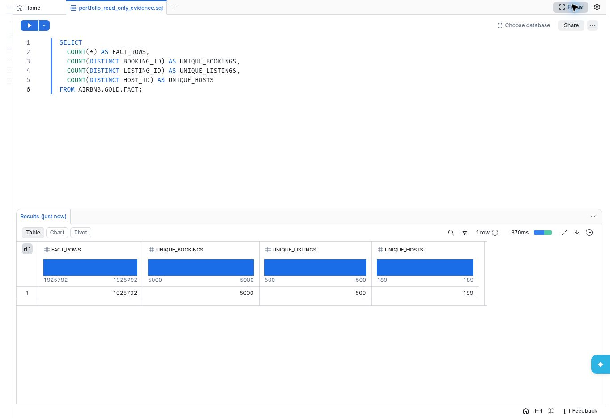
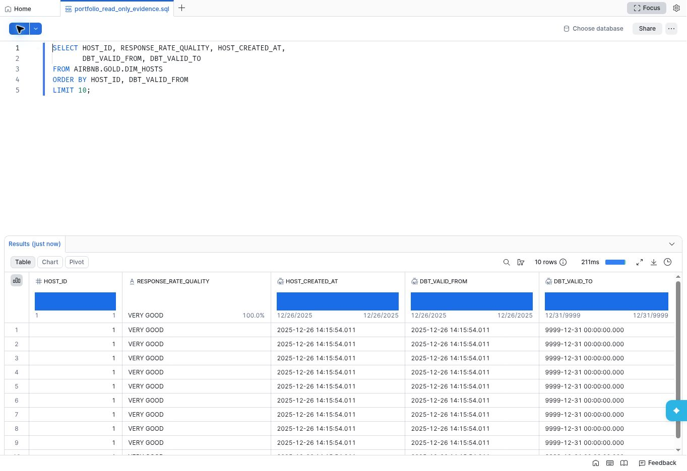
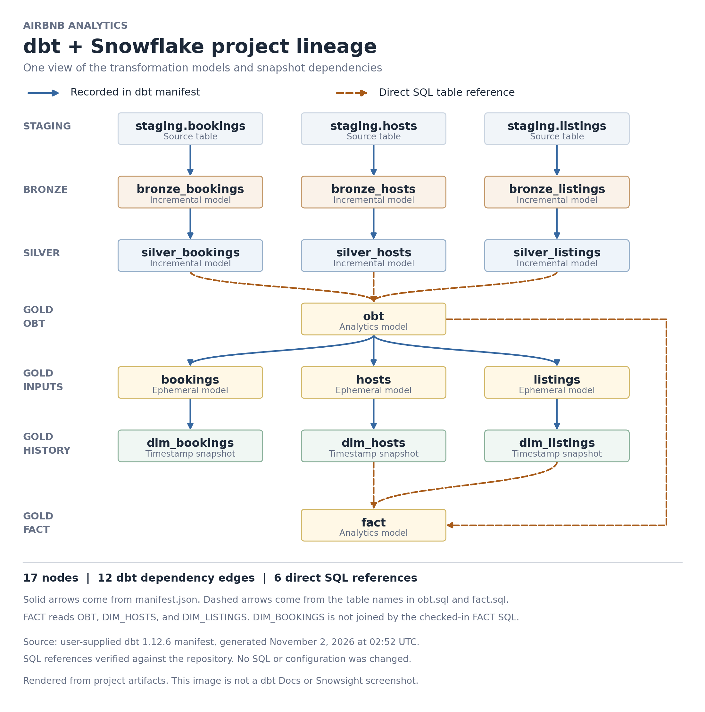

# Airbnb Analytics with dbt and Snowflake

A dbt project that transforms Airbnb booking, listing, and host data in
Snowflake. It demonstrates layered SQL transformations, incremental models,
reusable Jinja macros, and timestamp snapshots.

## Snowflake results and sample data

The screenshots below show read-only queries against `AIRBNB.GOLD` in Snowsight.

### Gold data overview



At capture time, `AIRBNB.GOLD.FACT` contained 1,925,792 rows representing
5,000 distinct booking IDs, 500 distinct listing IDs, and 189 distinct host IDs.
The total row count includes repeated booking IDs; it is not a count of unique
bookings.

### Host snapshot rows



This capture shows the existing host snapshot rows and their validity fields.
Repeated rows are visible in the result. A separate read-only query found no
host with more than one distinct `DBT_VALID_FROM` value at capture time, so this
image does not demonstrate a historical change between two versions.

Fictional example inputs: [bookings](docs/sample-data/bookings.csv),
[hosts](docs/sample-data/hosts.csv), and
[listings](docs/sample-data/listings.csv). These are reference samples, not
configured dbt seeds.

## dbt model lineage



Bookings, hosts, and listings move through Bronze and Silver before coming
together in Gold. Blue arrows show dbt dependencies; dashed amber arrows show
direct SQL table references.

## What this repository includes

This repository contains the dbt transformation layer. It expects the input
tables to already exist in `AIRBNB.STAGING`; it does not provision AWS
resources, ingest files from S3, or load data into Snowflake. Those upstream
steps are outside this project's scope.

```text
Upstream data delivery (not included)
                |
                v
       AIRBNB.STAGING
                |
                v
      Bronze incremental models
                |
                v
       Silver incremental models
                |
                v
       Gold analytics models
                |
                +---- Booking, host, and listing snapshots
```

## Data flow

### Source

[`models/sources/sources.yml`](models/sources/sources.yml) declares three
Snowflake source tables:

| Source | Relation |
|---|---|
| `staging.bookings` | `AIRBNB.STAGING.BOOKINGS` |
| `staging.hosts` | `AIRBNB.STAGING.HOSTS` |
| `staging.listings` | `AIRBNB.STAGING.LISTINGS` |

### Bronze

The `bronze_bookings`, `bronze_hosts`, and `bronze_listings` models select the
source rows and incrementally append records with a `created_at` later than the
latest value already in the target. Bronze models currently select all source
columns and do not declare a unique key.

### Silver

Silver models incrementally transform each entity and use its ID as a merge
key:

| Model | Key | Transformation |
|---|---|---|
| `silver_bookings` | `BOOKING_ID` | Calculates `total_amount` from nights booked and booking amount. |
| `silver_hosts` | `HOST_ID` | Normalizes host names and classifies host response rates. |
| `silver_listings` | `LISTING_ID` | Adds a price band (`Low`, `Medium`, or `High`). |

The `multiply` and `tag` macros hold reusable SQL expressions for these
calculations.

### Gold

- `obt` joins silver bookings to listings and hosts, keeping bookings as the
  base relation and using left joins for the related entities.
- `fact` selects analytics fields from the OBT and joins the gold listing and
  host dimension relations.
- `bookings`, `hosts`, and `listings` are ephemeral models used to shape the
  records consumed by snapshots; dbt inlines ephemeral SQL rather than creating
  separate tables for them.

Gold model SQL currently names Snowflake relations directly. The database and
schema names in those queries must match the objects in your Snowflake account.

### Snapshots and tests

The three snapshots (`dim_bookings`, `dim_hosts`, and `dim_listings`) use a
timestamp strategy and are configured for the `AIRBNB.GOLD` schema. Their
unique keys are booking, host, and listing IDs, respectively. They use the
corresponding `*_CREATED_AT` field as `updated_at`; source data should provide
timestamps that change when a record changes for snapshot history to be
meaningful.

`tests/source_tests.sql` checks for booking amounts below 200 and is configured
with warning severity. This is a small example data-quality check, not an
exhaustive test suite.

## Repository layout

```text
dbt_project.yml
models/
  sources/       Snowflake source declarations
  bronze/        Source-level incremental models
  silver/        Business transformations
  gold/          Analytics models and ephemeral snapshot inputs
macros/          Reusable SQL and schema naming logic
snapshots/       Booking, host, and listing history
tests/           Custom data-quality SQL
```

## Run locally

You need Python, dbt Core, the dbt Snowflake adapter, and access to a Snowflake
account containing the staging source tables.

1. Create and activate a virtual environment, then install the dbt packages:

   ```sh
   python3 -m venv .venv
   source .venv/bin/activate
   python -m pip install "dbt-core==1.12.6" "dbt-snowflake==1.12.4"
   ```

2. Create `~/.dbt/profiles.yml` with a profile named
   `aws_dbt_snowflake_project`, matching the profile name in
   [`dbt_project.yml`](dbt_project.yml). For example:

   ```yaml
   aws_dbt_snowflake_project:
     target: dev
     outputs:
       dev:
         type: snowflake
         account: <snowflake-account-identifier>
         user: <snowflake-username>
         authenticator: externalbrowser
         role: <snowflake-role>
         warehouse: <snowflake-warehouse>
         database: AIRBNB
         schema: <development-schema>
         threads: 4
   ```

   Replace the placeholders with values for your account. The Snowflake role
   needs permission to read `AIRBNB.STAGING` and create or update the target
   relations and snapshots. The custom schema macro uses the configured
   `bronze`, `silver`, and `gold` schemas for models with those schema settings.

3. From the repository root, check the connection, parse the project, and build:

   ```sh
   dbt debug
   dbt parse
   dbt build
   ```

`dbt build` runs models, tests, and snapshots in dependency order. To run only
the snapshots later, use `dbt snapshot`.

## Incremental behavior and operational notes

- Bronze uses a `created_at` watermark and appends newer rows. It will not
  automatically capture late-arriving rows whose timestamp is older than the
  current watermark.
- Silver uses its entity ID as a unique key, so rerun behavior is based on the
  adapter's incremental merge strategy.
- Snapshots rely on timestamps that reflect source changes. If `created_at`
  only records initial creation, later updates may not be captured.
- The Gold SQL uses explicit `AIRBNB.SILVER` and `AIRBNB.GOLD` relation names.
  Update those references if your database or schema layout differs.
- Keep credentials in the local dbt profile; do not commit profiles, passwords,
  private keys, or account-specific secrets. Generated dbt artifacts and logs
  are excluded from Git.

## Reference

This project was informed by Ansh Lamba's
[Airbnb End-To-End Data Engineering Project (For Beginners) | DBT + Snowflake +
AWS](https://www.youtube.com/watch?v=3SZSDKEZqoA&t=819s). Through which I was able to learn and create this project. Big shout out to him for this project!
